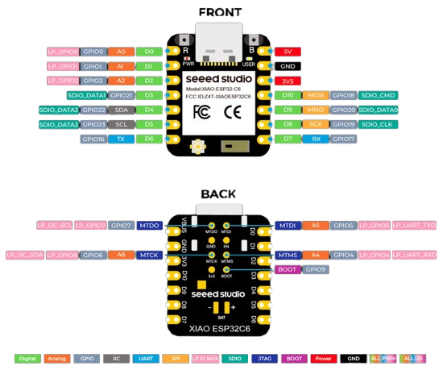

# Bir*DIY*

This project aims to recreate the beautiful air quality monitor from [Birdie Design](https://birdie.design/) at a lower cost, while adding smart home integration via Zigbee.

This little bird actively monitors your room's CO2 levels and physically drops down when it's time to open a window, while simultaneously sending the exact measurements to your smart home hub.

## Features

*   **Visual Air Quality Indicator:** The bird automatically drops down when CO2 levels exceed 1000 ppm and returns to its upright position when the air is fresh again.
*   **Zigbee Integration:** Acts as a Zigbee End Device, publishing CO2 and temperature data to your smart home network every 2 minutes.
*   **Smart Error Handling:** The bird rotates to specific angles to visually indicate hardware issues (e.g., sensor failure or Zigbee connection loss).

## Required Hardware

| Component | Notes |
|---|---|
| [Seeed Studio XIAO ESP32-C6](https://www.seeedstudio.com/Seeed-Studio-XIAO-ESP32C6-p-5884.html) | Microcontroller with Zigbee support |
| [28BYJ-48 4-Phase Stepper Motor + 5V driver board](https://www.amazon.de/Heevhas-28BYJ-48-Schrittmotor-Treiberplatine-Testmodul/dp/B0CW9ST4XM) | Drives the bird's tilting motion |
| [SCD41 Sensor Module](https://www.amazon.de/dp/B0FK53SJHB) | CO₂, temperature & humidity sensor |
| A button of some sort | e.g. for manual reset/calibration :) |

## Pin Connections

| Pin | Used for |
|---|---|
| GPIO 2 | Button (homing/reset, `INPUT_PULLDOWN`) |
| GPIO 17 | Stepper motor coil 1 |
| GPIO 19 | Stepper motor coil 2 |
| GPIO 20 | Stepper motor coil 3 |
| GPIO 18 | Stepper motor coil 4 |
| GPIO 22 (SDA) / GPIO 23 (SCL) | SCD41 CO₂ sensor (I2C, default board pins, address `0x62`) |


[Quelle Seeed Studio](https://wiki.seeedstudio.com/xiao_esp32c6_getting_started/#front)

## Configuration

The bird's behavior can be tuned by editing a few variables in the source code:

### Motor position & movement (`lib/stepper/Stepper.cpp`)

| Variable | Line | Default | Description |
|---|---|---|---|
| `motorSpeed` | 8 | `40.0` | Max stepper speed (steps/sec) |
| `motorAccel` | 9 | `200.0` | Stepper acceleration (steps/sec²) |
| `upPosition` | 10 | `1080` | Steps used for the homing move to reach the resting (up) position |
| `downPosition` | 11 | `1000` | Steps to move to for the "bird dropped" (down) position |


### Timing & thresholds (`src/main.cpp`)

| Variable | Line | Default | Description |
|---|---|---|---|
| `publishInterval` | 11 | `120000` (2 min) | How often CO2/temperature data is measured and published to Zigbee |
| `zigbeeRetryInterval` | 16 | `86400000` (24 h) | How often to retry the Zigbee connection if it's down |
| `co2Threshold` | 13 | `1000` ppm | CO2 level (in `loop()`, `currentCO2 >= 1000`) above which the bird drops down |

## Software & Installation

This project is built with [PlatformIO](https://platformio.org/).

1. Install the [PlatformIO extension](https://platformio.org/install/ide?install=vscode) for VS Code.
2. Clone this repository:
   ```bash
   https://github.com/Jakob-ui/birdiy.git
   ```
3. Open the folder in VS Code — PlatformIO will automatically download the required libraries listed in `platformio.ini`, including:
   - [`AccelStepper`](https://www.arduino.cc/reference/en/libraries/accelstepper/)
   - [`Sensirion I2C SCD4x`](https://github.com/Sensirion/arduino-i2c-scd4x)
4. Build and flash the firmware to your ESP32-C6 via PlatformIO.

## 3D Parts

All files required to build the bird and the housing are available here: [Link to 3D files](https://www.thingiverse.com/thing:7398266)